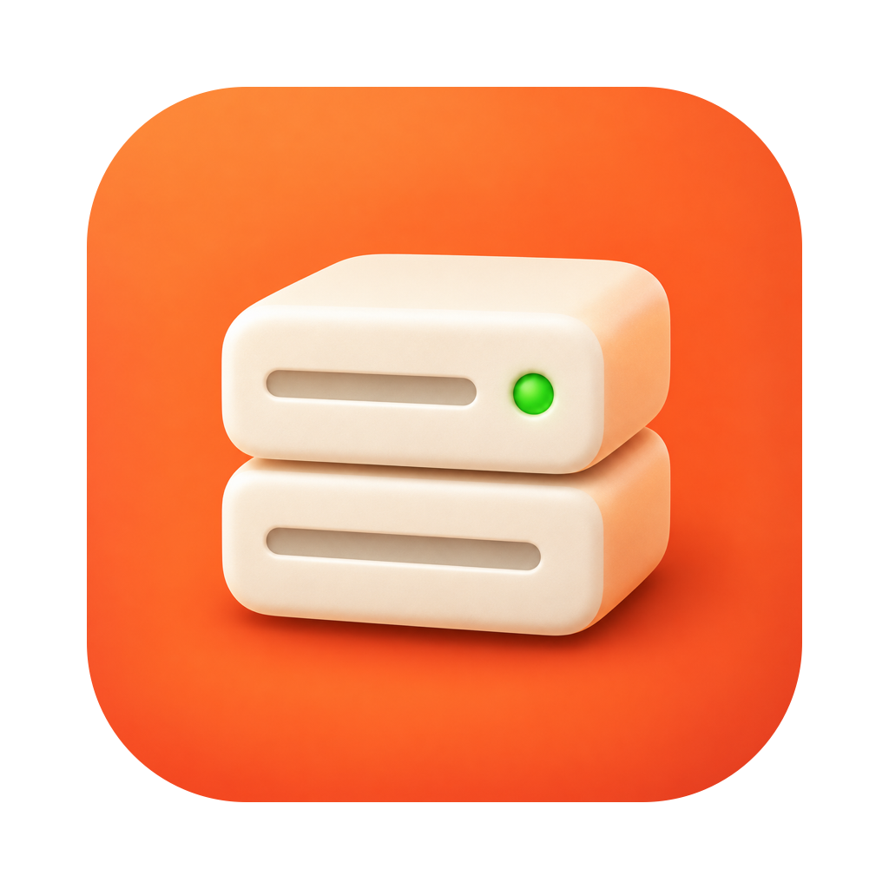
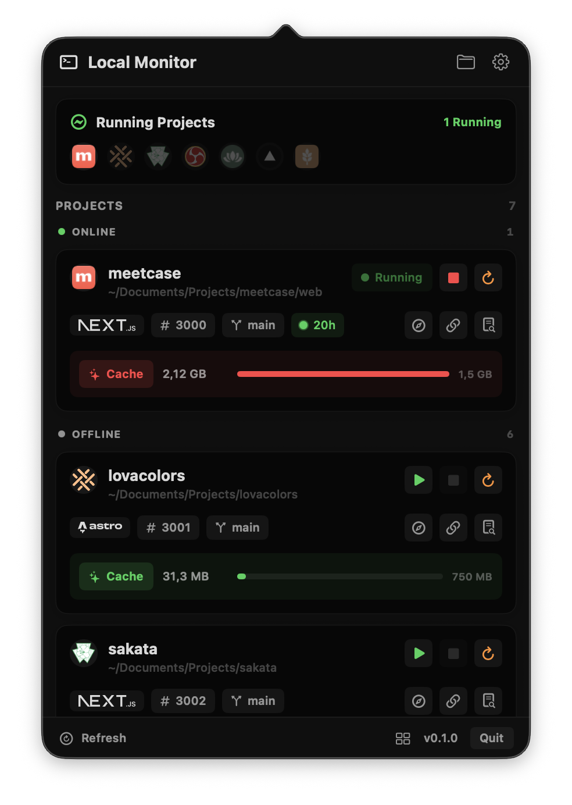
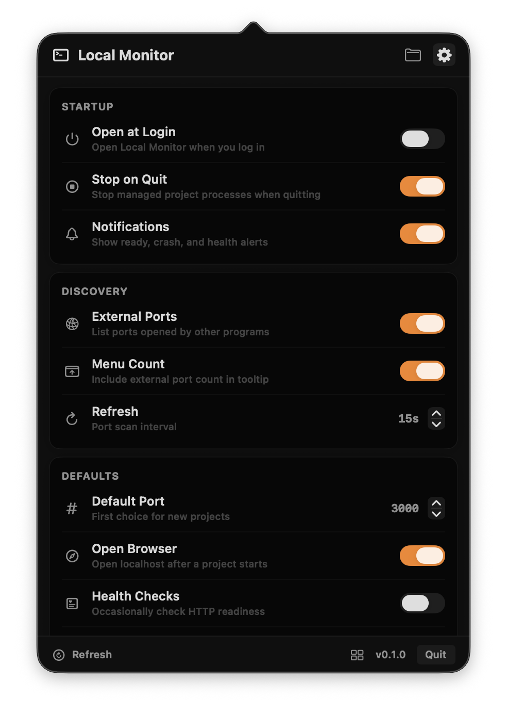

# Local Monitor

<p align="center">
  
</p>

**Native macOS menu bar control for local web projects and ports.** Start, stop, inspect, group, and clean local Next.js, Astro, Hono, and other dev servers right from your menu bar.

<p align="center">
  <a href="https://github.com/burakereno/localmonitor/releases/latest/download/LocalMonitor.dmg">
    
  </a>
  &nbsp;
  <a href="https://github.com/burakereno/localmonitor/releases/latest">
    
  </a>
</p>

<p align="center">
  <sub>macOS 14.0+ · local development servers only · Developer ID signed and notarized</sub>
</p>

<p align="center">
  
  
</p>

## Features

- **Project control** — start, stop, restart, and open local web projects from the menu bar
- **Project Node versions** — selects an installed Node runtime from project version files or package requirements before starting a server
- **Launch requirements** — checks package manager versions, dependency install fingerprints, and required environment keys before starting
- **Dependent services** — starts configured project dependencies in order and waits for health; supports explicitly selected Compose services with healthchecks
- **Project resources** — displays CPU and memory for each project's process tree, with bounded history and sustained-usage warnings
- **Failure diagnosis** — explains common startup errors and keeps a short, redacted failure history; automatic retries have backoff and a limit
- **Port awareness** — detects listening localhost ports and maps them back to project folders when possible
- **Framework detection** — detects Next.js, Astro, Hono, Vite, and other common local web app setups
- **Project icons** — reads favicon links declared by running sites and local HTML/Astro layouts, including nested icon paths; downloaded icons are cached on disk so they remain available after restarting Local Monitor with the site offline
- **Workspace apps** — detects runnable apps in npm workspace folders, lets you add other apps from a saved project's Workspace Apps button, and saves a separate working folder and launch command for each app
- **Local hostnames** — supports customer addresses such as `mirayoga.localhost`; browser links, copied URLs, and HTTP health checks use the saved hostname
- **Stable project ports** — stores each project's preferred port and warns when a process starts elsewhere
- **Online / offline grouping** — keeps running projects separated from stopped projects
- **Optional HTTP health checks** — allows 30 seconds for initial preparation and requires three consecutive failed checks before showing No Response; disabling checks uses listening ports only
- **Cache cleanup** — shows framework cache size and cleans Next.js / Astro cache folders on demand
- **Workspace groups** — start or stop saved groups of projects together
- **Logs and quick actions** — copy localhost URLs, open in browser, inspect logs, and reveal folders
- **One-click in-app updates** — checks GitHub releases, downloads the latest DMG, and installs it
- **Native macOS** — SwiftUI + AppKit, runs as a menu bar app

## Installation

### Download DMG

1. Go to the [Releases](../../releases/latest) page
2. Download **`LocalMonitor.dmg`**
3. Open the DMG and drag **Local Monitor.app** to your **Applications** folder

Release downloads are Developer ID signed and notarized. Double-click Local Monitor to launch it. The app appears in your menu bar and is shown as **Local Monitor**.

## Build from Source

### Requirements

- macOS 14.0+
- Xcode 16.0+
- Swift Package Manager

### Steps

```bash
git clone https://github.com/burakereno/localmonitor.git
cd localmonitor

swift test
./scripts/build-app.sh
open ".build/Local Monitor.app"
```

## Tech Stack

- **SwiftUI** — popover UI
- **AppKit** — NSStatusItem, NSPopover, app lifecycle
- **Swift Package Manager** — build system
- **lsof / ps** — local port and process discovery
- **GitHub Releases** — in-app update checks and DMG distribution

Release signing setup is documented in [docs/release-signing.md](docs/release-signing.md).

## Workspace Projects

Add the monorepo root containing `package.json` and its `workspaces` list. Local Monitor finds packages with a `dev` or `start` script and lets you select the apps to save. Each app runs its script directly in its own folder, so root npm wrappers cannot swallow port arguments. Ports declared in scripts and package managers declared at the workspace root are detected; hoisted `node_modules` are supported.

For a project such as meetcase-sites, Mirayoga and theme-preview get separate Start/Stop controls on ports 3100 and 3101. A single literal local hostname in Next.js `allowedDevOrigins` is suggested automatically; multiple origins keep `localhost` as the default. In Settings → Projects → Launch Settings, edit the command, hostname, or health check path. `{port}` in the command follows the saved port. Settings are saved and reused on every Start.

Use the grid-shaped **Workspace Apps** button on a project card or in Settings → Projects to add sibling apps. Already added apps show their saved hostname and port and cannot be added again; adding apps preserves their current settings and does not start, stop, or restart servers. Local Monitor checks current listeners during import and retains an app's declared port when that app is already running there.

For apps with several literal local addresses in `allowedDevOrigins`, the browser button offers the saved address plus each detected local hostname, all on the same running port. For example, theme-preview's catalogue and `luma.localhost` / `ritim.localhost` previews share one server and one Start/Stop profile. Wildcards and external origins are excluded. These addresses are browser shortcuts; the saved hostname still controls health checks and the default URL.

Saved workspace-root entries that still use a default launch command migrate to the app selected by the root workspace script when the new version opens. Existing custom commands, IDs, pins, and ports are retained. Projects that need a separate API server can select that saved project under Requirements & Services so it starts first and becomes healthy before the app launches.

## Project Node Versions

On Start, Local Monitor checks the app folder and its ancestors for `.nvmrc`, `.node-version`, or `package.json` → `volta.node`. The nearest declaration wins; `.nvmrc` takes precedence when both version files exist in one folder. If there is no pin, the nearest `package.json` → `engines.node` supplies the requirement. A child app's own pin overrides its workspace root.

Local Monitor selects the highest matching installed stable Node version. It discovers runtimes on PATH and in standard fnm, nvm, Volta, mise, asdf, and Homebrew installations, honoring their directory environment variables. Numeric pins, partial versions (`22`, `24.x`), comparison ranges (`>=22.23.4 <25`), caret, tilde, hyphen, and OR ranges are supported. Named aliases such as `lts/*` are resolved through an available fnm or nvm installation. Prerelease requirements and unsupported expressions produce an explicit error.

The selected Node directory is applied after login-shell initialization to both the package-manager preflight check and the server command. Logs show the selected version, executable, and declaration file. Projects without a declaration keep their existing environment, and custom launch commands are preserved. Commands that explicitly replace PATH or invoke an absolute Node executable retain that explicit override.

If the requested version is unavailable, Start reports the requirement and its source file. Install a matching version with your Node version manager, then start again. Local Monitor does not download runtimes, change global Node defaults, or edit shell configuration.

## Requirements, Services and Diagnostics

In **Settings → Projects → Requirements & Services**, choose required environment key names, the environment mode, project dependencies, Compose services, resource thresholds and retry limits. Old saved projects keep safe defaults and need no migration. Changing the package manager updates standard dev/start commands; custom commands remain editable in Launch Settings.

`packageManager` and `devEngines.packageManager` version declarations are checked in the selected Node environment. Matching installed tools or cached Corepack versions are used through project-local shims, including nested script invocations. Normal Start does not download tools or change global package manager defaults. Missing versions explain how to install them.

Open a project's **Requirements, Diagnostics & Logs** button to run a check or explicitly **Install Dependencies**. Installation is allowed only while the project is stopped, uses its workspace root, and preserves existing lockfiles with `npm ci`, pnpm/Bun frozen installs or Yarn immutable installs (classic Yarn uses frozen-lockfile). An installed Corepack may fetch a required manager during this explicit action. Cancel stops the owned command. Only successful installs record package/lockfile fingerprints and Node major; missing records are informational, while changed metadata or native-package runtime differences produce warnings. Installs performed outside Local Monitor cannot be certified automatically.

Required keys configured in settings block Start when absent or empty; `.env.example` and `.env.sample` keys only produce informational suggestions in Requirements & Diagnostics and do not appear as warnings on project cards. Checks follow Next.js or Vite-style file precedence, the chosen mode and actual exported shell variables. Hono/Wrangler checks use the selected `.dev.vars` file exclusively when present and recognize `--env`. Leading literal assignments in a launch command override files and shell values; computed assignments produce a warning without executing the expression. `auto` recognizes standard dev/start/build commands, `NODE_ENV` assignments and `--mode`; select a mode explicitly for custom scripts. Checks report key names only and do not evaluate project configuration code or display/persist secret values.

Project dependencies are checked for cycles and missing entries before anything starts. Backend health endpoints must respond before the frontend starts. Configure a useful Health Check Path for each dependency. Selected Compose services must have enabled healthchecks and use `docker compose up --detach --wait`; Docker/Compose must already be installed. Stopping a project cancels its pending startup but retains already-running shared dependencies and containers.

Resources are sampled from one process snapshot per refresh, including child processes and avoiding duplicate PIDs. Each project retains at most 40 samples for the current app session; warnings require three high samples or sustained memory growth and have a notification cooldown. Stopped projects retain their last measurements. Resource warnings never kill projects. Automatic restarts use 2/4/8-second increasing delays (capped at 30 seconds), default to three retries in five minutes, and pause when that budget is exhausted. Start resets the budget; crashes more than five minutes apart do not consume the same budget. Stop cancels queued retries, preflights and pending dependency startup. Stop All also cancels the remainder of bulk startup, and stopping a dependency cancels pending parent chains.

Failure history retains at most 20 structured diagnoses per project. It does not retain raw log excerpts or environment values; the existing project log remains available separately. Command checks and installations have time limits, bounded output capture and cancellation. No release or version bump is performed by these features.

For isolated UI verification in a debug bundle, set `LOCALMONITOR_PREVIEW_DIRECTORY` to a fixture directory containing `projects.json` and launch a bundle with a separate identifier. Release builds ignore this option; preview logs, installation records and tool shims stay in the fixture directory.
